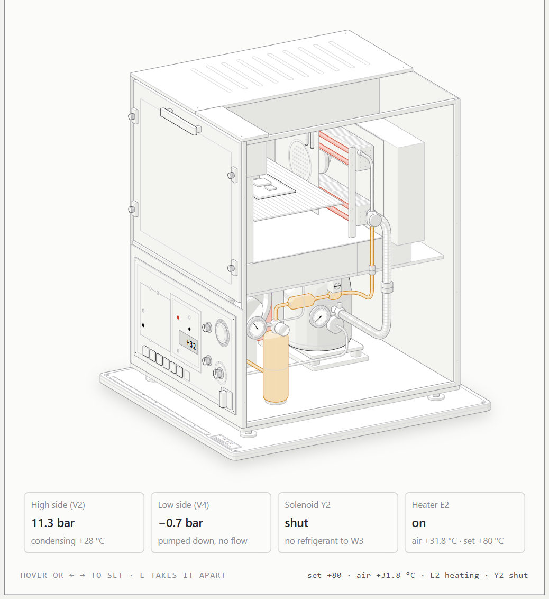
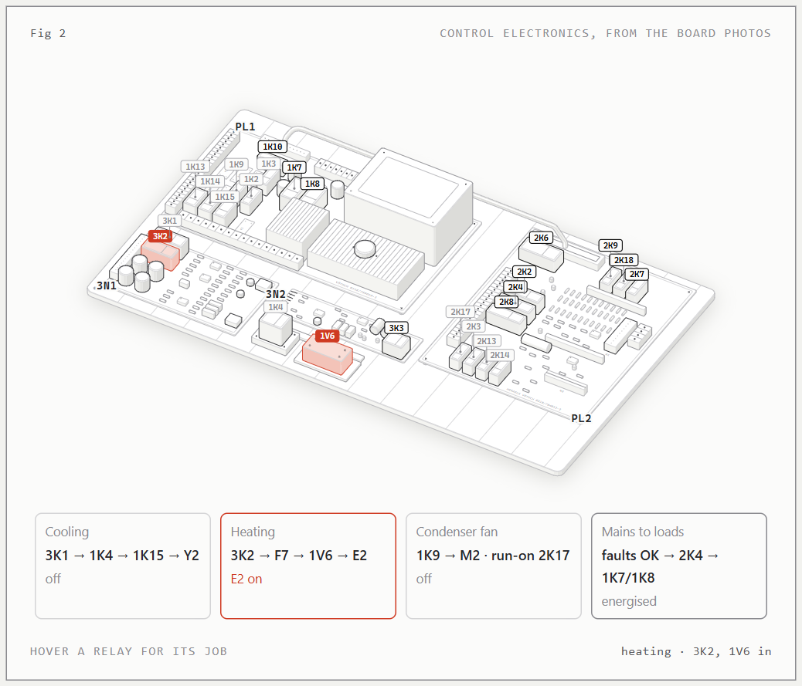
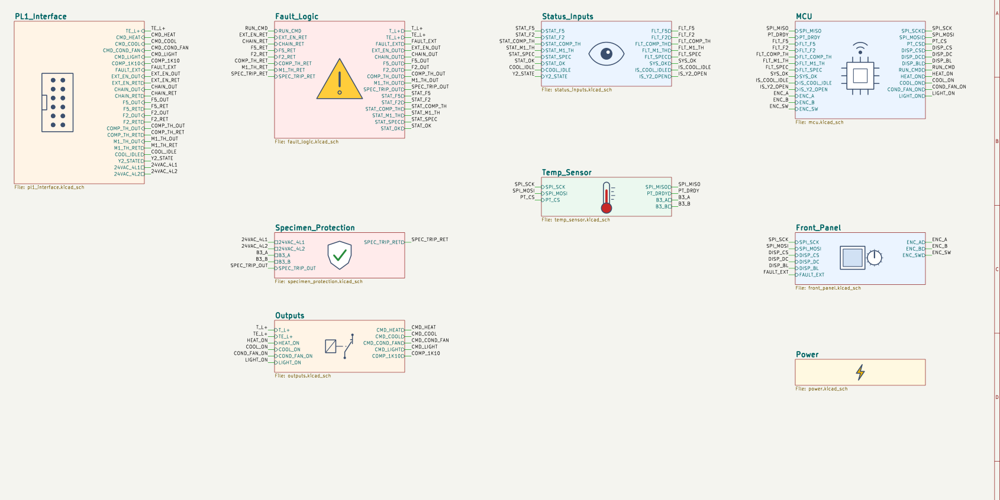

# VMT 04/16 Controller

> **🚧 Work in progress.** This is an early design, not a finished or working controller. The schematic is a first draft and partly unverified, no board has been made, and there is no firmware yet. Don't build from it.

A replacement Wi‑Fi controller for a 1984 Heraeus‑Vötsch VMT 04/16 climate chamber (‑40…+130 °C, R502, 220 V).

The goal is to replace the original analog controller card (3N1, LP81‑102) and front panel with one board with an ESP32‑S3, a display and a rotary encoder. The refrigeration and power side will stay as built: the PL1 base board, the hardware fault chain and the independent specimen protection card (3N2) will be kept.

**[▶ Open the interactive figure](https://marcowonders.github.io/VMT04-16_Controller/)**: how the chamber cools and heats, with live pressures, and which relays switch when.

[](https://marcowonders.github.io/VMT04-16_Controller/)

[](https://marcowonders.github.io/VMT04-16_Controller/)

## Status

| Step | State |
|---|---|
| Understand the original chamber ([interactive figure](https://marcowonders.github.io/VMT04-16_Controller/)) | Mostly done; some relay positions and jobs are still guesses |
| Signal list (`01_Design/Signal_list.md`) | Draft; open questions V1–V6 need measuring on the unit |
| Schematic: Power, MCU, Temp_Sensor, Front_Panel | First draft, not reviewed |
| Schematic: Fault_Logic, Outputs, Status_Inputs, Specimen_Protection | Placeholders only; waiting on PL1 measurements |
| PCB layout | Not started |
| Firmware | Not started |
| Prototype and testing in the chamber | Not started |

## Schematic

Draft top level of the KiCad project, likely to change: one block per function. Fault handling stays in hardware; the MCU only reads the fault states.



## Layout

```
00_Documentation   photos of the original boards
01_Design          signal list, anatomy figure sources
20_Hardware        KiCad 9 project (hierarchical)
docs               the built figure (GitHub Pages) and README images
```

The figure is built with `node 01_Design/anatomy/build.mjs`. It needs the Anatomy drawing kit, whose path is set at the top of `build.mjs`.

## Safety

This chamber runs on mains voltage and contains a pressurised refrigerant circuit. The over‑temperature and specimen protection stay in hardware on purpose; the microcontroller only reads the fault states. Nothing here is tested or certified. Build it at your own risk.

## About the original design

The Vötsch VMT 04/16 and its original electronics were designed by Heraeus‑Vötsch GmbH (now Weiss Technik). This is an independent hobby project. It is not affiliated with, endorsed by, or supported by Weiss Technik or Vötsch. Brand and product names are used only to say which machine this fits.

The original operating manual is not included in this repository. The descriptions of the original wiring here are my own notes and drawings, made from my own unit and its documentation.

If you represent the rights holder and want something changed or taken down, open an issue or email me at `marco@marme.nl`. I will respond promptly.

## License

- Hardware (`20_Hardware`): CERN‑OHL‑S‑2.0, see [LICENSE](LICENSE)
- Firmware, software and the figure: MIT, see [LICENSE-MIT](LICENSE-MIT)

The licenses cover only my own work in this repository, not the original Vötsch design.
